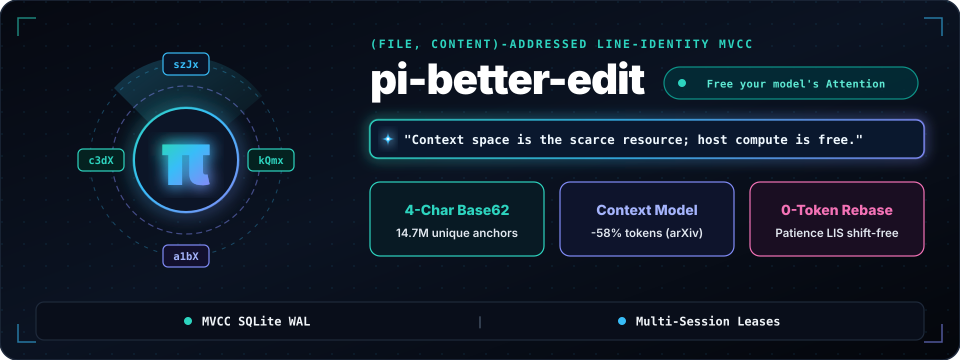

<p align="center">
  
</p>

<h1 align="center">pi-better-edit</h1>
<p align="center">
  <strong>Production-grade, hash-anchored file editing for &pi;.<br>
  Powered by (File, Content)-Addressed Line-Identity MVCC &mdash; no line numbers, no re-typing old code, no heuristic guessing, and zero silent miswrites.</strong>
</p>

<p align="center">
  <a href="#system-architecture"></a>
  <a href="#quick-start"></a>
  <a href="https://www.npmjs.com/package/pi-better-edit"></a>
  <a href="https://www.npmjs.com/package/pi-better-edit"></a>
  <a href="docs/reference/benchmarks.md"></a>
  <a href="LICENSE"></a>
</p>

<p align="center">
  <a href="#core-philosophy">Core Philosophy</a> •
  <a href="#empirical-evidence-token-savings--attention">arXiv & Attention Evidence</a> •
  <a href="#quick-start">Quick Start</a> •
  <a href="#configuration--settings">Config</a> •
  <a href="#tools">Tools</a> •
  <a href="#features">Features</a> •
  <a href="#multi-session-support-mvcc">Multi-Session (MVCC)</a> •
  <a href="#system-architecture">Architecture</a> •
  <a href="#error-and-warning-contract">Errors & Warnings</a> •
  <a href="#comparison">Comparison</a>
</p>

---

## Core Philosophy

### The Most Precious Resource is Context Space

In autonomous coding agent design, **the model's context window and attention budget are the single most scarce and expensive resource**. Conversely, **host runtime compute (hashing, diffing, snapshotting, and alignment) is effectively free**.

Traditional agent editing tools violate this fundamental economic reality:
1. **`str_replace` burns context**: Forcing the model to echo 30–50 lines of unchanged code ($O(S+R)$) burns expensive generation tokens and crowds out subsequent task reasoning.
2. **Context bloat degrades attention**: Long contexts trigger attention dispersion ("Lost in the Middle", Liu et al. 2023). Regurgitating boilerplate code pollutes the context with repetitive tokens that distract the model from subtle invariants.
3. **Line-number coordinates rot immediately**: Inserting one line shifts all subsequent lines down. Agents hallucinate coordinates, suffer off-by-one errors, or waste context on defensive full-file re-reads.

`pi-better-edit` shifts the entire burden of verification, coordinate tracking, snapshotting, and alignment to the host runtime:
- **$O(R)$ Edit Payloads**: The model emits only two 4-character hashes (`anchor_from`, `anchor_to`) plus the replacement text. It never regurgitates existing code.
- **Zero-Token Auto-Rebase**: Harmless exterior file shifts (format-on-save passes like Prettier or Black, git checkouts, concurrent edits) rebase seamlessly locally using $O(m \log m)$ Patience LIS alignment with a bounded DP fallback — **0 tokens burned, 0 retries**.
- **Fail-Closed Reject-and-Serve**: For same-file edits, contested spans fail closed without file corruption and immediately return current on-disk rows with fresh, valid leases in the error payload (`[E_STALE_RANGE]`, `[E_UNVERIFIED_RANGE]`), recovering in **exactly 1 turn** with no extra `read` call (`test/e2e/tool-battery.test.ts`).

---

## Empirical Evidence: Token Savings & Attention

The design of `pi-better-edit` is grounded directly in published empirical research on LLM context dynamics and tokenization:

### 1. Token Economics: 22%–58% Generated Token Savings
In published paired experiments on AI code editing, line-anchored feedback demonstrated a **22% (Claude Opus) and 58% (Claude Sonnet) reduction in generated tokens**, reaching **24%–80% savings on files of 100 lines or more** while improving overall patch correctness ([Lamberti 2026 preprint, arXiv:2607.12713](https://arxiv.org/abs/2607.12713)).
- Traditional search-and-replace tools require outputting $O(S + R)$ tokens.
- `pi-better-edit` requires only $O(R)$ output tokens.
- Self-serving diffs return updated anchors in the edit result, eliminating follow-up `read` calls when chaining edits.

### 2. Attention Preservation & Cognitive Headroom
Repeating massive blocks of existing code dilutes attention weights across the prompt. Research on transformer attention mechanisms demonstrates that:
- Extraneous context tokens increase needle-retrieval failure rates and degrade multi-step reasoning accuracy ("Lost in the Middle", Liu et al. 2023).
- Anchored editing keeps model output focused strictly on the intended change, preserving context space for reasoning traces, test outputs, and project architecture.

### 3. Tokenizer Drift Immunity
Subword tokenizers (BPE, WordPiece, Unigram) drift across model versions and architectures. As demonstrated by [TokDrift (Li, Deng, Nie 2025, arXiv:2510.14972)](https://arxiv.org/abs/2510.14972), semantically identical code snippets tokenize differently depending on superficial factors like whitespace, line coordinates, and formatting, causing significant behavioral shifts across LLMs.
- Traditional coordinate lines (`12:34|`, `@@ -1,5 +1,5 @@`) fragment into volatile multi-token sequences that trigger off-by-one errors.
- `pi-better-edit` addresses this by projecting line digests into **4-character base62 strings** (`[A-Za-z0-9]`) separated by `│` (U+2502) ([ADR-0002](docs/adr/0002-tokenizer-stable-4-character-anchors-canon-v3.md)). These anchors tokenize as a small fixed count (~3 tokens in ≥99% of measured samples) where width-3 anchors fragment unpredictably, ensuring stable copy-target references across model families.

---

## Quick Start

### Installation

Install as an extension into [`pi`](https://github.com/can1357/oh-my-pi):

```bash
# From npm (recommended)
pi install npm:pi-better-edit

# From GitHub
pi install git:github.com/Rianico/pi-better-edit

# From local directory (for development)
pi install ./local-package
```

Zero configuration required. `pi` automatically detects and activates `pi-better-edit` on startup.

| Requirement | Supported Version |
| :--- | :--- |
| **Node.js** | &ge; 24.0.0 (`.nvmrc` 26) |
| **pi-coding-agent** | &ge; 0.75.0 (peer dependency) |

### 30-Second Workflow

#### 1. Read the file
`read` returns lines prefixed by stable 4-character hash anchors:

```text
ve7x│function calculateTotal(items: CartItem[]): number {
szJx│  let total = 0;
kQmx│  for (const item of items) {
m2zX│    total += item.price;
d2xX│  }
p9rX│  return total;
a1bX│}
```

#### 2. Apply an edit
`edit` targets inclusive anchor bounds using the flat named-object payload:

```json
{
  "file": "src/cart.ts",
  "edits": [
    {
      "anchor_from": "szJx",
      "anchor_to": "m2zX",
      "text": "  let total = items.reduce((sum, item) => sum + item.price, 0);\n"
    }
  ]
}
```

#### 3. Receive self-serving diff with fresh anchors
The response returns a unified diff with newly allocated anchors for modified lines, allowing immediate follow-up edits without a re-read:

```text
- szJx│   let total = 0;
- kQmx│   for (const item of items) {
- m2zX│     total += item.price;
+ w4kQ│   let total = items.reduce((sum, item) => sum + item.price, 0);
  d2xX│   }
```

---

## Configuration & Settings

Settings are partitioned into two distinct roots ([ADR-0005](docs/adr/0005-store-janitor-two-root-lifecycle.md)):
1. **Settings Root** (human configuration): `${PI_CODING_AGENT_DIR:-~/.pi/agent}/extensions/pi-better-edit/settings.json` (global) or `.pi/agents/pi-better-edit/settings.json` (project-local).
2. **State Root** (internal MVCC CAS database): `${XDG_STATE_HOME:-~/.local/state}/pi-better-edit/` (relative `$XDG_STATE_HOME` counts as unset per [ADR-0005](docs/adr/0005-store-janitor-two-root-lifecycle.md); stores `hash-store.sqlite`, legacy `hash-store.json`, and `diagnostics.log`).

Override the layout globally via `PI_BETTER_EDIT_CONFIG_DIR=/path/to/dir` (places settings at `<dir>/settings.json` and state at `<dir>/state/` without suffix). Environment variables (`PI_BETTER_EDIT_BASH_VIEW`, `PI_BETTER_EDIT_LENS_BRIDGE`, `PI_BETTER_EDIT_STORE_JANITOR*`) override file settings.

### Interactive Settings & Slash Commands

Run the interactive settings overlay inside `pi`:
```text
/pi-better-edit settings
```
- `/pi-better-edit` (alias `/pi-better-edit settings`): Interactive overlay inspecting active effective settings across env, project, and global rungs. Headless hosts receive structured status text.
- `/pi-better-edit bash-view [on|off|status] [project|global]` (alias `/pi-better-edit bash ...`): Configures Bash View interception. Subcommand `multi-file [status | max-files N | max-rows N]` tunes multi-file limits.
- `/pi-better-edit lens [auto|on|off|status] [project|global]`: Configures pi-lens bridge. `/pi-better-edit lens status` reports resolved store and bridge states.

---

## Tools

`pi-better-edit` registers three core tools that replace pi's default file manipulators:

### 1. `read`
Returns file content formatted as `HASH│content` with active session leases.

```typescript
read({
  file: "src/index.ts",
  windows?: [          // Disjoint window slices (up to 16 ranges)
    { offset: 1, limit: 50 },            // Line offset slice (default limit: 50)
    { around_anchor: "kQmx", radius: 5 } // Anchor-centered neighborhood slice
  ],
  mode?: "served"      // "served" (default, grants leases) | "verbatim" (raw text, no hashes)
})
```
- **Whole-File vs Windowed Reads**: Omitting `windows` reads the entire file from line 1. Supplying `windows` scopes the output to up to 16 disjoint slices (either `{ offset, limit }` or `{ around_anchor, radius }`).
- **Disjoint Multi-Window Leases**: In the default `served` mode, every row across all returned windows receives an active lease, enabling batched edits across distant parts of the file in the subsequent turn.
- **Large-Line Protection**: Individual lines exceeding pi's `DEFAULT_MAX_BYTES` (50 KB) are replaced with a concise unservable placeholder marker to prevent context explosion.

### 2. `edit`
Applies atomic single or batched modifications.

```typescript
edit({
  file: "src/index.ts",
  edits: [
    {
      anchor_from: "szJx",
      anchor_to: "szJx",
      text: "  const maxRetries = 5;\n",
      at?: "in-place"   // "in-place" (default) | "before" | "after"
    }
  ],
  mode?: "general"      // "general" (default) | "literal" (declares served-row bytes as intended content)
})
```

#### Edit Payload Contract
An edit item carries **flat, discriminator-free semantics**: exactly one payload per item (supply `text` or `text_ref`, both or neither refused naming the offending keys).

| Item key | Values | Meaning |
| :--- | :--- | :--- |
| `anchor_from` / `anchor_to` | bare 4-char hash anchors | Inclusive target range — both boundary lines are touched. |
| `at` (optional) | `"in-place"` \| `"before"` \| `"after"` | Placement relative to the resolved range. **Omitted means `"in-place"`.** `"before"`/`"after"` insert at the range boundary and require a single-line resolved target; the underscore spelling `"in_place"` is refused — the canonical spelling is `"in-place"`. |
| `text` | string | By-value payload — bare file content (`\n` joins lines). **`""` deletes the range when placed in-place** (no `at`). With `"before"`/`"after"` an empty `text` does NOT delete: it writes nothing and the call narrates `[W_NOOP_INSERT]` as a no-op. |
| `text_ref` | `{ anchor_from, anchor_to, file?, mode }` | By-reference payload — the bytes of a `served span` bounded by two anchors of the file it names. `mode` is **required** (never inferred): `"copy"` re-inserts the span and keeps the source; `"cut"` additionally retires it. `file` may name another served file — a **foreign-source copy** (never called "cross-file" here; that word named a dropped multi-file batching idea). Both modes apply to a foreign file, and a foreign `cut` commits insert and retirement as one correlated transaction. |

##### Example Items
- **In-place replacement**: `{ anchor_from: "a1bX", anchor_to: "c3dX", text: "new code\n" }`
- **In-place deletion**: `{ anchor_from: "a1bX", anchor_to: "c3dX", text: "" }`
- **Before / After insertion**: `{ anchor_from: "kQmx", anchor_to: "kQmx", at: "after", text: "// note\n" }`
- **By-reference copy**: `{ anchor_from: "m2zX", anchor_to: "m2zX", text_ref: { anchor_from: "d2xX", anchor_to: "d2xX", mode: "copy" } }`
- **By-reference cut**: `{ anchor_from: "m2zX", anchor_to: "m2zX", text_ref: { anchor_from: "d2xX", anchor_to: "e5vX", mode: "cut" } }`
- **Foreign-source cut**: `{ anchor_from: "m2zX", anchor_to: "m2zX", text_ref: { anchor_from: "g7tX", anchor_to: "h3sX", file: "src/helper.ts", mode: "cut" } }`

### 3. `undo_last_edit`
Restores the exact previous file content, BOM, line endings, and original anchors.
```typescript
undo_last_edit({ path: "src/index.ts" })
```
- Backed by snapshot-pinned undo records in the CAS store; survives agent restarts.
- Refuses with `[E_UNDO_STALE]` if the file was modified externally after the last edit.

---

## Features

### Interoperability with `pi-lens`
`pi-better-edit` deeply integrates with [`pi-lens`](https://github.com/apmantza/pi-lens) language intelligence:
- **Symbol / Section Widening**: Partial reads (`limit <= 100`) are automatically widened to enclosing function symbols or markdown sections (budget: 300 lines, 200ms). Anchors describe the lines actually served.
- **Formatter & Autofix Immunity**: Whitespace rewrites by formatters during deferred passes are absorbed by the 28-code-point whitespace class ([ADR-0002](docs/adr/0002-tokenizer-stable-4-character-anchors-canon-v3.md)). Note that zero-width characters (U+200B ZWSP) are deliberately excluded; formatters rewriting ZWSP to a space rotate the anchor and fail closed safely.
- **v2 I/O Bridge Compatibility**: Every served line and mutation (reads, bash views, diffs, reject-and-serve rows, `write` tool calls) is reported to the `pi-lens:io-bridge`, satisfying the read-before-edit guard with zero redundant `read` calls.

### Bash View Interception
Pure views and searches (`cat`, `cat -n`, `nl -ba`, `head`, `tail`, `sed -n`, `grep`, `rg`, `rg --files`) are intercepted: raw stdout is swapped for the same lines as `HASH│content` rows under a `[Bash view: <file> (<N> lines total | lines A-B of <N> total)]` header, and the rows carry working leases, so the next `edit` needs no re-read ([ADR-0006](docs/adr/0006-ast-guarded-bash-view-interception.md)).
- **Display transforms & context**: Also served are display tails (`cat -A`, `cat -vet`, `od -c`, `xxd`, `hexdump -C`), context windows (`grep -A/-B/-C`, `rg -C`), and verified compound chains with an inert count tail ([ADR-0006](docs/adr/0006-ast-guarded-bash-view-interception.md)).
- **Standalone multi-file views**: Multi-file views (`cat FILE…`, `sed -n RANGE FILE…`) are served, capped at 10 files and 2,000 rows ([ADR-0006](docs/adr/0006-ast-guarded-bash-view-interception.md)).
- **Passed through byte-identical**: Pipelines with transforms, unverified compounds, errors, truncation, and any command writing to stderr pass through unmodified.

---

## Multi-Session Support (MVCC)

`pi-better-edit` v2 introduces first-class multi-session support for single workspaces through MVCC:

### How MVCC Isolates Sessions
- **Session-Keyed Leases**: Leases are keyed to `(session_id, file_path, anchor)` in `served_leases`. Session identity is retrieved from `ctx.sessionManager.getSessionId()`.
- **Zero Cross-Session Authority**: Anchors served to Session A authorize nothing in Session B. Session B calling an edit with A's anchors is rejected with `[E_UNKNOWN_ANCHOR]` (or `[E_FOREIGN_ANCHOR]` if served for another file).
- **Concurrent Edits as External Changes**: If Session A mutates lines 1–5 while Session B holds leases for lines 20–30, Session B's edit **auto-rebases cleanly** without error.
- **Fail-Closed Contention**: If Session A modifies lines that Session B targets, Session B's edit fails closed with `[E_STALE_RANGE]` and returns fresh rows.
- **Persistent Continuation**: In the pi agent runtime, resuming a session preserves the session ID (e.g. via `pi -c`), ensuring previously served anchors remain valid across restarts.

> [!WARNING] Concurrency Recommendation
> While MVCC makes multi-session operation inside a single workspace safe against data corruption, **running concurrent coding agents against the exact same workspace files is not recommended**. Agents can race on intermediate states or suffer merge churn.
> 
> **Recommended Pattern:** Use **isolated git worktrees** (`git worktree`) per agent role (e.g. Task Manager, Implementer, Reviewer), as practiced in multi-agent environments using isolated worktrees.

---

## System Architecture

```text
┌──────────────────────────────────────────────────────────────────────────────────┐
│                                STORAGE TIER                                      │
│  src/hash-store.ts & src/snapshot-store/ (Principal Tables)                      │
│  - file_snapshots: CAS snapshots (snapshot_id, path, snapshot_hash, line_count)  │
│  - line_lineage: Coordinate authority (snapshot_id, line_number) -> (line_id)    │
│  - line_id_counters: Monotonic integer block allocator per path                  │
│  - served_leases: Session-keyed leases (session_id, file_path, anchor)           │
│  - file_undo: Snapshot-pinned undo record per path, surviving restarts           │
│  - cut_intent: Transaction recovery for correlated cross-file cuts              │
└────────────────────────────────────────┬─────────────────────────────────────────┘
                                         │
┌────────────────────────────────────────▼─────────────────────────────────────────┐
│                                SESSION TIER                                      │
│  src/served-session/session.ts                                                   │
│  - Leases: Granted on all serve paths (read, diff, write auto-read, bash view)   │
│  - Immutability: Leases are strictly READ-ONLY during edit resolution            │
│  - Re-Serve Upsert: Atomic upsert updates leases when presentation changes       │
└────────────────────────────────────────┬─────────────────────────────────────────┘
                                         │
┌────────────────────────────────────────▼─────────────────────────────────────────┐
│                       RESOLUTION & REBASE TIER                                   │
│  src/hashline/lease-resolve.ts & src/served-session/serve-render.ts             │
│  - On-Demand CAS Materialization: Materializes current disk state                │
│  - Patience LIS Pin Backbone: O(m log m) alignment with bounded DP fallback      │
│  - Minimal Displacement Tie-Breaking: Deterministic unique pairing               │
│  - Span Contiguity Gate: Asserts interior span is not torn                       │
└────────────────────────────────────────┬─────────────────────────────────────────┘
                                         │
┌────────────────────────────────────────▼─────────────────────────────────────────┐
│                                MUTATION TIER                                     │
│  src/mutation-engine/pipeline.ts & src/hashline/apply.ts                         │
│  - Working Buffer: Preceding delta rebase for multi-item batches                 │
│  - WAL Lineage Commit: Atomically commits final snapshot and updates leases      │
│  - Fail-Closed Intercepts: Rejections emit fresh read ranges                     │
└──────────────────────────────────────────────────────────────────────────────────┘
```

### 1. Anchor Generation Pipeline
1. **Frozen Whitespace Canonicalization**: Strips a frozen 28-code-point class ([ADR-0002](docs/adr/0002-tokenizer-stable-4-character-anchors-canon-v3.md)) before hashing. Formatter passes (`prettier`, `black`, `gofmt`) leave anchors intact.
2. **xxHash32 & Base62 Space**: Canonical lines are hashed using xxHash32 seeded with the file's canonical path and projected into 4-character base62 strings (`A-Za-z0-9`), yielding $62^4 - 10^4 = 14,766,336$ allocatable anchors per file (all-digit spellings reserved to prevent confusion with line numbers).
3. **Coprime Collision Probing**: Duplicate lines probe with a stride coprime to the hash space ($62^2 + 62 + 1 = 3,907$). Every line in a file receives a guaranteed unique anchor.

### 2. Multi-Version Snapshot Lineage
Every file modification commits a new CAS snapshot to `file_snapshots`. The `line_lineage` table tracks the monotonic `line_id` for every line coordinate, maintaining coordinate-independent identity across arbitrary external shifts.

---

## Error and Warning Contract

`pi-better-edit` enforces a strict diagnostic contract ([ADR-0004](docs/adr/0004-model-tool-boundary-and-error-protocol.md)). Rejections report machine-actionable `details.cause` values (`retirement`, `never-served`, `served-range staleness`). Detailed cause classifications and refusal-scoped options are documented in **[Error and Warning Contract Reference](docs/reference/error-and-warning-contract.md)**.

### Domain Rejections (`[E_*]`)

| Error Code | Description | Served Options |
| :--- | :--- | :--- |
| `[E_BAD_PAYLOAD]` | Payload fails schema validation (missing fields, wrong types). | — |
| `[E_MALFORMED_ANCHOR]` | Anchor is not valid — not a bare 4-char base62 token. | — |
| `[E_STALE_ANCHOR]` | Anchor no longer resolves to its leased identity in the file snapshot. | — (the served rows are the state) |
| `[E_UNKNOWN_ANCHOR]` | The path has not served the anchor in this session. | — |
| `[E_FOREIGN_ANCHOR]` | Anchor was served for a different file, not the targeted one. | — |
| `[E_STALE_RANGE]` | A line in the edit range changed on disk, or a boundary line was never served ([ADR-0004](docs/adr/0004-model-tool-boundary-and-error-protocol.md)). | — (the fresh read is the state) |
| `[E_UNVERIFIED_RANGE]` | One boundary lease retired while surviving bound is live and unshifted ([ADR-0004](docs/adr/0004-model-tool-boundary-and-error-protocol.md)). | — (the fresh read is the state) |
| `[E_TARGET_LOST]` | Target line identity deleted or reordered without stable anchor bounds. | — |
| `[E_SUSPICIOUS_TEXT]` | Replacement line starts with a served `HASH│` anchor prefix. | Omit anchor prefixes or set `mode: "literal"`. |
| `[E_BATCH_ABORT]` | Two or more items in the batch target overlapping spans. | Merge overlapping spans or split calls. |
| `[E_NOOP_LOOP]` | Identical edit submitted 3 consecutive times without change; range already has this text. | — |
| `[E_EMPTY_RANGE]` | Edit would result in an invalid empty state on a non-empty file target. | — |
| `[E_NOT_FOUND]` | Target file does not exist on disk. | — |
| `[E_ACCESS]` | Target file is unreadable, unwritable, or in a circular symlink loop. | — |
| `[E_UNSUPPORTED_FILE]` | Target path is a directory, binary file, image, or UTF-16/32 text. | — |
| `[E_LOSSY_TEXT]` | File bytes do not round-trip clean UTF-8 decode without data loss. | — |
| `[E_UNDO_STALE]` | Cannot undo: file was modified or deleted externally after the last edit. | — |
| `[E_UNDO_UNAVAILABLE]` | Cannot persist undo snapshot to CAS store. Disk left unchanged. | Retry edit or use write. |
| `[E_UNDO_REVERT_FAILED]`| Correlated cross-file cut transaction was interrupted mid-revert. | — |
| `[E_LARGE_FILE]` | Exceeds admission budget (200,000 lines `SERVED_MAX_LINES`) or anchor address space. | Fact-only (per [ADR-0004](docs/adr/0004-model-tool-boundary-and-error-protocol.md)). |
| `[E_INTERNAL_INVARIANT]`| Internal MVCC or CAS store invariant failed. | — |
| `[E_UNKNOWN]` | Unexpected filesystem or runtime exception. | — |

### Applied Warnings (`[W_*]`)

| Warning Code | Audience | Description |
| :--- | :--- | :--- |
| `[W_NEVER_SERVED_SHAPE]` | `[MODEL]` | Replacement line starts with an anchor-shaped token never served in this session. Applied verbatim. |
| `[W_SERVED_PREFIX_MISMATCH]` | `[MODEL]` | Replacement line starts with a served anchor but content differs. Applied verbatim. |
| `[W_REVERSED_ANCHORS]` | `[USER]` | Anchors were reversed (`anchor_from` after `anchor_to`). Swapped and applied cleanly. |
| `[W_UNICODE_LITERAL]` | `[USER]` | Replacement text contains literal `\uDDDD` sequence. Applied verbatim. |
| `[W_LITERAL_BYPASS]` | `[USER]` | Served-echo check bypassed by literal declaration. |
| `[W_NOOP]` | `[USER]` | Identical edit submitted a 2nd consecutive time without changing range text. Resend triggers `[E_NOOP_LOOP]`. |
| `[W_NOOP_INSERT]` | `[MODEL]` | Empty insertion with `before`/`after` writes zero bytes. |

---

## Comparison

### Capability Matrix

| Feature | **pi-better-edit v2** | @oh-my-pi/hashline | Traditional `str_replace` |
| :--- | :--- | :--- | :--- |
| **Addressing Model** | 4-char (file, content)-addressed anchors | File tag + line numbers | Verbatim code strings |
| **Line Identity** | Immutable MVCC `line_id` | Coordinate line numbers | None (text matching) |
| **Exterior Shift Tolerance** | **Auto-rebases** (0 tokens, 0 retries) | Model must recalculate line numbers | Fails if surrounding context shifts |
| **Duplicate Line Safety** | **Collision-resolved** unique anchors | Ambiguous position-based indexing | Prone to matching wrong instance |
| **Concurrent Disk Drift** | **Fail-closed reject-and-serve** | Tag mismatch refusal | Silent overwrite or text-mismatch error |
| **Batch Support** | **Atomic** up to 32 items with delta shifts | Patch preflight | Single replacement per call |
| **Undo Persistence** | **Survives restarts** (CAS snapshot pinned) | In-memory / per-process | In-memory / per-process |
| **Session Isolation** | Session-keyed leases (`served_leases`) | Process-global / unkeyed | Process-global / unkeyed |
| **Deterministic Battery** | 27 deterministic scenarios in CI (`test/e2e/tool-battery.test.ts`) | — | — |

Detailed edge-case test matrices, recovery behaviors, and benchmark datasets are documented in **[Benchmarks & Comparison Reference](docs/reference/benchmarks.md)**.

---

## License

[MIT](LICENSE)

## Acknowledgments

- [**Can Bölük**](https://stencil.so/blog/the-harness-problem) for seminal insights on *The Harness Problem*.
- [**@oh-my-pi**](https://github.com/can1357/oh-my-pi) by can1357 for pioneering the hashline patch concept.
- [**pi-hashline-edit-pro**](https://github.com/YuGiMob/pi-hashline-edit-pro) by YuGiMob for foundational agent extension designs.
